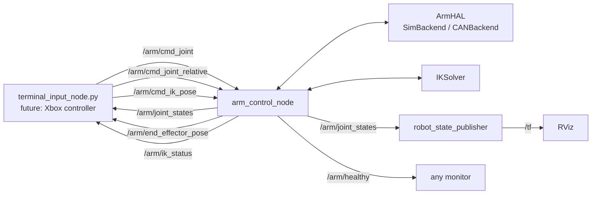

# rover_arm

ROS 2 (Jazzy) package for controlling the rover's 6-joint arm. It accepts joint commands or Cartesian tool-tip targets, solves inverse kinematics (IK), and sends the result to a hardware backend. The backend is either a simulator or the CAN bus (not yet implemented).

## Quick start

```bash
colcon build --packages-select rover_arm
source install/setup.bash

# arm_control_node + robot_state_publisher + RViz
ros2 launch rover_arm display.launch.py            # backend:=sim (default) or backend:=can

# In a second terminal: keyboard input
ros2 run rover_arm terminal_input_node.py

# Tests
colcon test --packages-select rover_arm && colcon test-result --verbose
```

## How it fits together



Input sources only publish commands. `arm_control_node` owns the arm: it runs IK, sends joint targets to the HAL, and publishes feedback at a fixed rate (20 Hz by default).

## Topics

| Topic | Type | Direction | Data |
|---|---|---|---|
| `/arm/cmd_joint` | `sensor_msgs/JointState` | in | Absolute joint targets (rad), by joint name. Any subset of joints. Cancels any active IK goal. |
| `/arm/cmd_joint_relative` | `sensor_msgs/JointState` | in | Joint deltas (rad) in the `position` field, by joint name. Cancels any active IK goal. |
| `/arm/cmd_ik_pose` | `geometry_msgs/PoseStamped` | in | Tool-tip target XYZ (m). Only position is used. |
| `/arm/joint_states` | `sensor_msgs/JointState` | out | Current positions of all 6 joints (rad), from the HAL. |
| `/arm/end_effector_pose` | `geometry_msgs/PoseStamped` | out | Current tool-tip XYZ from forward kinematics, frame `base_link`. |
| `/arm/ik_status` | `std_msgs/String` | out | `IK OK` or `IK failed: <reason>` after each solve. |
| `/arm/healthy` | `std_msgs/Bool` | out | Backend health flag. |

Joint order everywhere (also the HAL index): `turret_joint`(0), `shoulder_joint`(1), `elbow_joint`(2), `wrist_roll_joint`(3), `wrist_pitch_joint`(4), `hand_joint`(5).

## Files

| Path | Purpose |
|---|---|
| `src/arm_control_node.cpp` | Main node. Subscribes to the command topics, runs IK, drives the HAL, publishes feedback. |
| `include/arm_hal.hpp` | `ArmHAL` interface: joint indices/names and the calls every backend implements. |
| `src/sim_backend.cpp`, `include/sim_backend.hpp` | Simulated arm. Moves joints with a trapezoidal profile (≤ 1 rad/s) and clamps to URDF limits. |
| `src/can_backend.cpp`, `include/can_backend.hpp` | CAN backend stub (not yet implemented). CAN node IDs are HAL index + 1. |
| `src/ik_solver.cpp`, `include/ik_solver.hpp` | KDL-based position IK from `base_link` to `tool_tip`. Solves turret, shoulder and elbow while holding the wrist where it is. If that fails, retries with wrist pitch free ("reach assist"). |
| `src/joint_limits.cpp`, `include/joint_limits.hpp` | Parses joint limits out of `robot_description`. |
| `scripts/terminal_input_node.py` | Keyboard input: joint mode, IK mode (type XYZ), jog mode (hold keys), and `home` / `calibrate`. |
| `config/config.yaml` | Calibrated home pose (joint angles), written by `calibrate` in the terminal node. |
| `urdf/rover_arm.urdf`, `meshes/` | Arm model (SolidWorks export, hand-corrected). `tool_tip` is the point IK positions. |
| `launch/display.launch.py` | Starts `arm_control_node`, `robot_state_publisher` and RViz, and passes the URDF to both. |
| `urdf.rviz` | RViz config. |
| `test/` | gtests for the sim backend, CAN stub and IK solver. |

## How an IK command flows

1. An input publishes a target on `/arm/cmd_ik_pose`.
2. Every tick, `arm_control_node` moves an intermediate target up to 5 mm from the current tool tip toward the goal and solves IK for it. The solver starts from the current joint angles.
3. Only the joints IK solved for are sent to the HAL. The wrist and hand stay under operator control.
4. The goal finishes once the final target is solved. It is dropped after 5 consecutive IK failures, or when any `/arm/cmd_joint*` command arrives.

## Known limitations

- **Joint speed near the edge of reach.** Each tick moves the target a fixed 5 mm in Cartesian space. Near full extension, a 5 mm step can need up to ~0.14 rad of joint motion per tick (~2.8 rad/s), which is more than the 1 rad/s joint limit. The arm then lags behind the target. A velocity-based control mode is planned to fix this.
- **`frame_id` is ignored.** IK targets on `/arm/cmd_ik_pose` are always treated as being in `base_link`, whatever the message header says.
- **Joint states are matched by order, not name.** `arm_control_node` expects `/arm/joint_states` to list joints in the order above.
